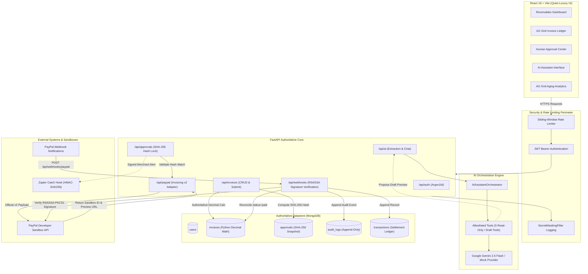

# PAYFLOW AI

> Autonomous, Approval-Gated Accounts Receivable Agent for Freelancers and Independent Studios.  
> Built for the **PayPal AI Hackathon** by **Team XyphX**.

[](LICENSE)
[](https://fastapi.tiangolo.com)
[](https://reactjs.org)
[](https://developer.paypal.com)
[](https://www.ag-grid.com)
[]()

---

## 1. System Architecture

PAYFLOW AI combines a high-performance **FastAPI** backend with an **editorial quiet-luxury React** frontend. The AI assistant acts strictly as an untrusted proposal generator; all writes and PayPal Sandbox interactions require explicit merchant authorization.



---

## 2. How PayPal and AI Are Used

### How PayPal Is Used (Official REST Invoicing API v2)
PAYFLOW AI interacts deeply with the official **PayPal REST Invoicing API v2** (`/v2/invoicing/invoices`):
1. **OAuth2 Bearer Token Lifecycle**: Acquires tokens via client-credentials grant against `https://api-m.sandbox.paypal.com/v1/oauth2/token` and caches them in worker memory until safe expiry (`expires_in - 120s`).
2. **Official Schema Mapping**: Internal models map authoritatively to PayPal's documented JSON structure (`detail`, `invoicer`, `primary_recipients`, `items`, `amount`).
3. **Idempotent Dispatch**: Uses a stable `PayPal-Request-Id` idempotency header. If network timeouts occur, the service queries PayPal (`GET /v2/invoicing/invoices/{id}`) to reconcile state rather than duplicating invoices.
4. **Payer View Persistence**: Stores and displays official PayPal preview URLs (`https://www.sandbox.paypal.com/invoice/s/pay/{id}`) for client settlement.
5. **Cryptographic Webhook Verification**: Ingested `INVOICING.INVOICE.PAID` webhooks are verified with PayPal's official `/v1/notifications/verify-webhook-signature` endpoint. Invoices are **never** marked `paid` without verified cryptographic status (`verification_status: "SUCCESS"`).
6. **Strict Sandbox Invariant**: `PAYPAL_BASE_URL` is hardcoded to `https://api-m.sandbox.paypal.com`. Live endpoints are rejected at startup.

### How AI Is Used (Google Gemini & Structured Tool Calling)
PAYFLOW AI uses **Google Gemini 2.5 Flash** (with automatic zero-config **MockAIProvider** fallback for offline evaluation):
1. **Natural Language Invoice Extraction**: Converts unstructured requests (e.g. *"Create a $2,400 invoice for Globex for Brand Redesign due in 14 days"*) into structured drafts.
2. **Clarification Barrier**: If client name, currency, or due date are ambiguous or missing, the model asks clarifying questions instead of hallucinating amounts or currencies.
3. **Human-in-the-Loop Safeguard**: Extracted drafts return with `is_suggestion=True`. The LLM cannot write to the database or contact PayPal directly; the merchant must review and confirm the draft.
4. **Prompt Injection & Data Minimization**: Customer notes and external strings are scrubbed of secrets and demarcated as untrusted data blocks. System instructions forbid tool loop recursion (hard limit: **5 tool calls per conversational turn**).
5. **Contextual Payment Reminders**: The AI generates respectful, customer-specific follow-ups across 6 deterministic aging stages without aggressive or harassing language.
6. **Read-Only Receivables Intelligence**: Backed strictly by actual database aggregates; quotes exact invoice citations and separates currencies strictly.

---

## 3. Team XyphX

Built with pride for the **PayPal AI Hackathon**:
- **Team**: **XyphX**
- **Members**:
  - Gayathry Rajeev ([@gayurajeev](https://github.com/gayurajeev))
  - Sidharth ([@callmesidhu](https://github.com/callmesidhu))

---

## 4. Sponsor Integrations & Status

| Sponsor / Technology | Status | Implementation Details |
| :--- | :--- | :--- |
| **AG Grid** | **Integrated & Active** | Official `ag-grid-react` and `ag-grid-community` v36 libraries powering the Invoices Explorer (`/invoices`) and Customer Receivables Balances (`/analytics`). Features multi-column sorting, column filters, real-time quick search, pagination, and CSV export, styled in editorial quiet-luxury design tokens. |
| **Postman** | **Verified & Included** | Complete Postman Collection v2.1.0 at [`docs/postman/PayflowAI.postman_collection.json`](docs/postman/PayflowAI.postman_collection.json) covering 11 folders and 30+ requests with collection variables and webhook simulation guide. |
| **APIMatic** | **Applied in Workflow** | Installed via `npx context-plugins install paypal -y` ([docs/apimatic-usage.md](docs/apimatic-usage.md)). Guided OAuth token caching, idempotency header verification, and official Invoicing v2 schema mapping. |
| **Zapier** | **Integrated & Active** | Secure merchant notification automation ([docs/zapier-integration.md](docs/zapier-integration.md)). Approved reminders dispatch signed HMAC-SHA256 payloads to Zapier Catch Hooks. Triggered only after explicit merchant approval. |
| **Bryntum** | **Evaluated & Omitted** | Evaluated per Prompt 26. Required commercial registry authentication (`npm.bryntum.com`). Adhering to prompt instructions (*"Document actual usage only"*), Bryntum was omitted from Devpost claiming. |

---

## 5. Local Development Setup

### Prerequisites
- **Python 3.11+** (Python 3.12 or 3.13 supported)
- **Node.js 18+** (Node 22 LTS recommended)
- **MongoDB** (Local instance or free MongoDB Atlas cluster)
- **PayPal Developer Sandbox Account** ([developer.paypal.com](https://developer.paypal.com))

---

### Setup on macOS / Linux (Bash or Zsh)

#### 1. Backend Setup
```bash
# Clone the repository
git clone https://github.com/gayurajeev/FastAPI-PAYFLOW-AI-hackathon.git
cd FastAPI-PAYFLOW-AI-hackathon

# Copy environment template
cp .env.example backend/.env

# Navigate to backend
cd backend

# Create and activate Python virtual environment
python3 -m venv .venv
source .venv/bin/activate

# Install dependencies
pip install -r requirements.txt

# Run automated tests (all 145 tests)
pytest tests/ -v

# Start FastAPI development server
uvicorn app.main:app --reload --port 8000
```
- API Base URL: `http://127.0.0.1:8000`
- Interactive OpenAPI Docs: `http://127.0.0.1:8000/docs`
- Health Diagnostic: `http://127.0.0.1:8000/health`

#### 2. Frontend Setup
Open a second terminal window:
```bash
cd FastAPI-PAYFLOW-AI-hackathon/frontend

# Install dependencies
npm install

# Run linter / typecheck
npm run lint

# Start Vite development server
npm run dev
```
Open `http://localhost:5173` in your browser.

---

### Setup on Windows (PowerShell)

#### 1. Backend Setup
```powershell
# Clone the repository
git clone https://github.com/gayurajeev/FastAPI-PAYFLOW-AI-hackathon.git
cd FastAPI-PAYFLOW-AI-hackathon

# Copy environment template
Copy-Item .env.example backend\.env

# Navigate to backend
cd backend

# Create and activate virtual environment
python -m venv .venv
.venv\Scripts\Activate.ps1

# Install dependencies
pip install -r requirements.txt

# Run automated test suite
pytest tests -v

# Start FastAPI server
uvicorn app.main:app --reload --port 8000
```

#### 2. Frontend Setup
Open a second PowerShell terminal:
```powershell
cd FastAPI-PAYFLOW-AI-hackathon\frontend

# Install dependencies
npm install

# Typecheck
npm run lint

# Start Vite development server
npm run dev
```

---

## 6. Standalone Interactive Demo Runner (Zero Setup Required)

For judges who want to evaluate the full interactive application without configuring a local MongoDB instance or external PayPal credentials, PAYFLOW AI provides an **in-memory standalone demo runner**:

```bash
# In the backend directory:
python -m app.demo_runner
```

```bash
# In the frontend directory:
npm run dev
```

### Pre-Seeded Evaluation Account:
- **Email**: `demo@payflowai.com`
- **Password**: `DemoPassword2026!`
- **One-Click Sign In**: Click the `[ Fill Local Demo Credentials ]` button on the `/login` route.
- **Pre-Seeded Data**: Pre-populated with Net-14 and Net-30 enterprise clients (Acme Global, Globex, Stark Advisory), an approved invoice, an overdue invoice with an AI-generated respectful reminder draft, a settled PayPal invoice with chronological audit trail, and AG Grid receivables analytics.

---

## 7. Environment Variable Reference

| Variable | Required? | Default Value | Description |
| :--- | :--- | :--- | :--- |
| `APP_ENV` | Optional | `development` | Runtime environment (`development`, `test`, `production`). In production, CORS wildcard and live PayPal URLs are blocked. |
| `APP_SECRET_KEY` | **Required** | `dev-insecure-secret...` | Cryptographic secret for signing JWTs and HMAC hashes. Must be >= 32 characters in production. |
| `PORT` | Optional | `8000` | Port for the Uvicorn web service. |
| `FRONTEND_ORIGIN` | Optional | `http://localhost:5173` | Comma-separated allowed origins for CORS. |
| `MONGODB_URI` | **Required** | `mongodb://localhost:27017` | MongoDB connection URI (local or MongoDB Atlas connection string). |
| `MONGODB_DATABASE` | Optional | `payflow_ai` | Target MongoDB database name. |
| `PAYPAL_BASE_URL` | **Locked** | `https://api-m.sandbox.paypal.com` | PayPal REST API base host. Strictly restricted to Sandbox. |
| `PAYPAL_CLIENT_ID` | Optional* | `""` | PayPal Sandbox Client ID from Developer Dashboard. |
| `PAYPAL_CLIENT_SECRET` | Optional* | `""` | PayPal Sandbox Secret from Developer Dashboard. |
| `PAYPAL_WEBHOOK_ID` | Optional* | `""` | Configured Webhook ID for signature verification. |
| `AI_PROVIDER` | Optional | `gemini` | AI Provider: `gemini` or `mock`. Fallback to mock occurs gracefully if key is omitted. |
| `AI_API_KEY` | Optional* | `""` | Google Gemini API key. If omitted, built-in mock orchestrator handles all intents. |
| `AI_MODEL` | Optional | `gemini-2.5-flash` | Gemini model name. |
| `ZAPIER_CATCH_HOOK_URL`| Optional | `""` | Server-side Zapier Catch Hook endpoint for reminder dispatch notifications. |
| `ZAPIER_SHARED_SECRET` | Optional | `""` | Shared secret for signing Zapier webhooks with HMAC-SHA256 (`X-PayFlow-Signature`). |

*\* If PayPal or Gemini credentials are omitted, the application runs gracefully using verified local mock adapters and fallbacks.*

---

## 8. Database Setup Guides

### Option A: MongoDB Atlas (Free Cloud Database)
1. Sign up for a free MongoDB Atlas account at [mongodb.com/atlas](https://www.mongodb.com/atlas).
2. Create a free **M0 Sandbox** cluster.
3. Under **Database Access**, create a database user (e.g., `payflow_user`) and password.
4. Under **Network Access**, add IP `0.0.0.0/0` (allow access from anywhere) or your specific IP.
5. Click **Connect** &rarr; **Drivers** &rarr; copy the connection string:
   ```env
   MONGODB_URI=mongodb+srv://payflow_user:<password>@cluster0.abcde.mongodb.net/?retryWrites=true&w=majority
   MONGODB_DATABASE=payflow_ai
   ```

### Option B: Local MongoDB (macOS / Linux / Windows)
- **macOS**: `brew tap mongodb/brew && brew install mongodb-community && brew services start mongodb-community`
- **Linux**: `sudo systemctl start mongod`
- **Windows**: Start the MongoDB service from Windows Services Manager or Docker: `docker run -d -p 27017:27017 --name mongo mongo:latest`

---

## 9. PayPal Developer Sandbox Setup Guide

1. Log in to the [PayPal Developer Dashboard](https://developer.paypal.com).
2. Navigate to **Apps & Credentials** &rarr; select the **Sandbox** tab &rarr; click **Create App**.
3. Copy the generated **Client ID** and **Secret** to your `backend/.env`.
4. Navigate to **Testing Tools** &rarr; **Webhooks Simulator** (or configure a Sandbox Webhook on your app):
   - Webhook URL: `https://<YOUR-TUNNEL-OR-HOST>/api/webhooks/paypal`
   - Subscribed Event: `Invoicing invoice paid` (`INVOICING.INVOICE.PAID`)
5. Copy the generated **Webhook ID** to `PAYPAL_WEBHOOK_ID` in `backend/.env`.

---

## 10. Automated Testing & Verification

PAYFLOW AI includes **145 automated tests** covering unit, integration, security, and end-to-end flows:

```bash
cd backend
pytest tests/ -v
```

### Key Test Suites:
- `tests/test_e2e_integration.py`: Complete 12-stage lifecycle from registration to settled PayPal webhook.
- `tests/test_security_review.py`: Login and AI sliding-window rate limiting, secret masking, cert URL SSRF defense, status mutation prevention.
- `tests/test_webhooks.py`: Cryptographic webhook verification, replay attack rejection, signature tampering protection.
- `tests/test_paypal_invoice.py`: Invoicing v2 payload structure, idempotent dispatch, safe error mapping.
- `tests/test_approvals.py`: SHA-256 payload snapshot hash binding and tampering invalidation.
- `tests/test_ai_assistant.py`: Prompt injection defenses, secret scrubbing, multi-tenant isolation.

See [`docs/e2e-test-plan.md`](docs/e2e-test-plan.md) for the repeatable judge testing plan.

---

## 11. Production Deployment on Render

PAYFLOW AI is configured for one-click deployment to **Render** via Infrastructure-as-Code ([`render.yaml`](render.yaml)):
- **Backend**: FastAPI Web Service (`payflow-ai-backend`) with Uvicorn multi-worker start command, automated health checks (`/health`), and CORS isolation.
- **Frontend**: React + Vite Static Site (`payflow-ai-frontend`) with SPA rewrite rules (`/*` $\rightarrow$ `/index.html`).
- **Cron Worker**: Optional dedicated reminder worker (`payflow-daily-reminders`).

For deployment instructions and environment blueprints, see [Render Deployment Guide](docs/render-deployment.md).

---

## 12. Submission Gallery & Screenshots

All 13 high-resolution quiet-luxury screenshots are captured from the running application and cataloged in [`docs/screenshots/`](docs/screenshots):

| Screenshot | Description |
| :--- | :--- |
| [`01_login_desktop.png`](docs/screenshots/01_login_desktop.png) | Editorial sign-in with quick local demo credential shortcut. |
| [`01_login_mobile.png`](docs/screenshots/01_login_mobile.png) | Responsive mobile login screen (390x844). |
| [`02_register_desktop.png`](docs/screenshots/02_register_desktop.png) | Business owner onboarding screen. |
| [`03_dashboard_receivables_desktop.png`](docs/screenshots/03_dashboard_receivables_desktop.png) | Receivables dashboard with currency breakdown and black feature panel. |
| [`03_dashboard_receivables_mobile.png`](docs/screenshots/03_dashboard_receivables_mobile.png) | Mobile dashboard view with collapsible navigation drawer. |
| [`04_ag_grid_invoices_desktop.png`](docs/screenshots/04_ag_grid_invoices_desktop.png) | AG Grid Community invoice explorer with multi-column sorting and filtering. |
| [`04_ag_grid_invoices_mobile.png`](docs/screenshots/04_ag_grid_invoices_mobile.png) | Mobile invoice ledger with horizontal scrolling container. |
| [`05_invoice_detail_timeline_desktop.png`](docs/screenshots/05_invoice_detail_timeline_desktop.png) | Invoice detail view with line items and chronological activity audit trail. |
| [`06_approvals_center_desktop.png`](docs/screenshots/06_approvals_center_desktop.png) | Human Approval Center with pending invoice dispatches and reminders. |
| [`07_ai_assistant_desktop.png`](docs/screenshots/07_ai_assistant_desktop.png) | AI accounts receivable assistant with interactive suggestions. |
| [`08_customers_directory_desktop.png`](docs/screenshots/08_customers_directory_desktop.png) | Customer directory with Net payment terms and billing addresses. |
| [`09_analytics_aging_aggrid_desktop.png`](docs/screenshots/09_analytics_aging_aggrid_desktop.png) | Receivables aging buckets (0–7, 8–30, 31–60, 60+ days) and AG Grid balance explorer. |
| [`10_settings_paypal_diagnostics_desktop.png`](docs/screenshots/10_settings_paypal_diagnostics_desktop.png) | PayPal Developer Sandbox connectivity diagnostics and webhook health. |

---

## 13. Security Model & Invariants

For complete threat modeling, STRIDE analysis, and risk mitigations, see [`docs/security.md`](docs/security.md).

### Non-Negotiable System Invariants:
1. **Zero Secret Leakage**: No API keys, database URIs, or PayPal secrets in version control, browser bundles, or server logs.
2. **Deterministic Financial Math**: Monetary calculations execute via Python `Decimal` on the backend only.
3. **Multi-Tenant User Isolation**: Every database interaction is scoped to the authenticated `user_id`.
4. **Human-in-the-Loop Barrier**: The AI prepares proposals; the business owner explicitly authorizes PayPal sends.
5. **Strict Sandbox**: All PayPal operations strictly target the PayPal Sandbox (`api-m.sandbox.paypal.com`).
6. **Append-Only Auditing**: Zero update or delete routes exist for audit logs or settled financial transactions.

---

## 14. Submission & Video Resources

- **Demo Video Script (Prompt 37)**: [`docs/video-demo-script.md`](docs/video-demo-script.md) — Word-for-word, timestamp-by-timestamp script under 3 minutes with visual action cues and YouTube setup.
- **Devpost Submission Package (Prompt 38)**: [`docs/devpost-submission.md`](docs/devpost-submission.md) — Complete copy-paste fields, project story, truthful sponsor attestations, eligibility verification, and pre-submission checklist.
- **Judge Walkthrough Guide**: [`docs/DEMO_GUIDE.md`](docs/DEMO_GUIDE.md) — 2–3 minute scenario walk-through with zero-setup local demo instructions.
- **Observability & Recovery Guide (Prompt 40)**: [`docs/diagnostics-and-recovery.md`](docs/diagnostics-and-recovery.md) — Correlation IDs, safe error classification, `/api/diagnostics`, and incident recovery protocols.
- **Visual Assets**: [`docs/submission-assets/`](docs/submission-assets/) — Devpost 3:2 cover thumbnail and live application screenshots.

---

## 15. License

This project is licensed under the terms of the **MIT License**. See the [LICENSE](LICENSE) file at the repository root for details.

Copyright (c) 2026 Team XyphX.
