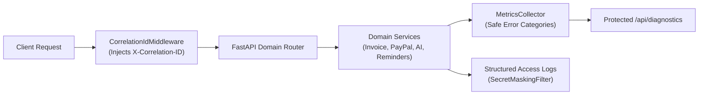

# PAYFLOW AI — Operational Observability, Diagnostics, and Incident Recovery (Prompt 40)

> **Document Version:** 1.0.0  
> **Target Audience:** System Operators, Evaluators, and Support Engineers  
> **Security Invariant:** Zero secrets, zero authorization tokens, and zero customer PII are logged or exposed via diagnostics.

---

## 1. Observability Architecture

PAYFLOW AI enforces end-to-end tracing and error categorization through an in-memory, zero-dependency telemetry pipeline:



### Key Capabilities:
1. **Correlation & Request Tracing:** Every HTTP transaction carries an `X-Correlation-ID` and `X-Request-ID` header. If provided by an upstream proxy, the ID is preserved; otherwise, a UUID4 is generated.
2. **Secret & Credential Masking:** The `SecretMaskingFilter` intercepts log outputs, automatically masking OAuth access tokens, passwords, and API secrets.
3. **Safe Error Categorization:** Errors are mapped to standardized enum categories (`ErrorCategory`) rather than dumping raw database exceptions or internal stack traces to clients.

---

## 2. Standardized Error Categories

| Error Category | Scope | HTTP / Internal Trigger | Description |
|---|---|---|---|
| `api_validation_error` | API | HTTP 400, 422 | Client payload schema validation failure or malformed body. |
| `api_auth_error` | API | HTTP 401, 403 | Missing, expired, or invalid JWT Bearer token. |
| `api_rate_limited` | API | HTTP 429 | Sliding-window request quota exceeded (auth or AI endpoint). |
| `api_not_found` | API | HTTP 404 | Target resource does not exist or belongs to another tenant. |
| `api_server_error` | API | HTTP 500 | Unhandled internal exception. |
| `paypal_auth_failure` | PayPal | OAuth token rejection | Invalid or expired PayPal Sandbox client ID/secret. |
| `paypal_network_timeout`| PayPal | HTTP 504 / timeout | Sandbox REST API connection timeout (exceeded 10s budget). |
| `paypal_api_rejection` | PayPal | HTTP 400–422 | PayPal API rejected payload (e.g. invalid currency, duplicate invoice). |
| `ai_key_missing` | AI | Startup / invocation | `AI_API_KEY` not configured; system switches to MockAIProvider. |
| `ai_provider_unavailable`| AI | HTTP 503 / timeout | Upstream Gemini API unreachable or model quota exhausted. |
| `ai_tool_execution_error`| AI | Internal tool call | Tool schema failure or domain exception during function call. |
| `webhook_signature_invalid`| Webhook | HTTP 401 | PayPal certificate validation or RSASSA signature mismatch. |
| `webhook_replay_attack` | Webhook | Event duplicate | Previously processed event ID re-transmitted; skipped idempotently. |
| `webhook_malformed_header`| Webhook | HTTP 400 | Missing `paypal-transmission-sig` or related cryptographic headers. |
| `scheduler_job_error` | Reminders| Job execution | Reminder evaluation failure on one or more overdue invoices. |

---

## 3. Protected Diagnostics Endpoint (`/api/diagnostics`)

The diagnostics endpoint provides a real-time health snapshot without exposing sensitive environment variables:

```bash
curl -H "Authorization: Bearer <TOKEN>" http://localhost:8000/api/diagnostics
```

### Sample Response (Redacted of all secrets):
```json
{
  "status": "healthy",
  "timestamp": "2026-11-10T17:35:00.000000Z",
  "environment": "development",
  "services": {
    "backend": {
      "status": "healthy",
      "app": "PAYFLOW AI",
      "version": "0.1.0"
    },
    "database": {
      "status": "connected",
      "database_name": "payflow_ai"
    },
    "paypal_sandbox": {
      "configured": true,
      "connected": true,
      "target_host": "https://api-m.sandbox.paypal.com",
      "webhook_configured": true,
      "message": "Successfully connected to PayPal Sandbox REST API."
    },
    "ai_provider": {
      "provider": "gemini",
      "model": "gemini-2.5-flash",
      "configured": true,
      "fallback_mode": false,
      "status": "active"
    }
  },
  "metrics": {
    "api": {
      "total_requests": 142,
      "errors_by_category": {},
      "error_rate_pct": 0.0
    },
    "paypal": {
      "total_calls": 8,
      "failures_by_category": {}
    },
    "ai_provider": {
      "total_calls": 14,
      "failures_by_category": {}
    },
    "webhooks": {
      "total_events": 3,
      "verification_failures": {}
    },
    "scheduler": {
      "total_runs": 12,
      "failures_by_category": {}
    }
  },
  "recovery_guidance": {
    "ai_unavailable": "Manual invoice creation at /invoices/new remains 100% operational.",
    "paypal_unavailable": "Invoices remain saved as local drafts; approval states preserved.",
    "webhook_failure": "Merchants can manually trigger status reconciliation via Settings.",
    "database_interruption": "Verify network access and MongoDB Atlas IP allowlist."
  }
}
```

---

## 4. Incident Recovery Protocols

### Scenario A: AI Provider Outage or Rate Limiting
* **Symptom:** AI Assistant returns `ai_provider_unavailable` or HTTP 429.
* **Degradation State:** Graceful fallback. Natural language extraction is paused.
* **Recovery Steps:**
  1. Business owners can continue issuing invoices manually via **Invoices → Create Invoice** (`/invoices/new`).
  2. All monetary calculations, approval hash locks, and PayPal dispatches execute independently of the AI model.
  3. When upstream Gemini API recovers, conversational assistance resumes automatically without restart.

---

### Scenario B: PayPal Developer Sandbox Outage or Network Timeout
* **Symptom:** Invoice dispatch fails with `paypal_network_timeout` or HTTP 504.
* **Degradation State:** Safe draft preservation.
* **Recovery Steps:**
  1. The invoice remains in `pending_approval` or `approved` state in the local database.
  2. The SHA-256 approval hash is preserved, preventing unauthorized tampering.
  3. Once PayPal Sandbox connectivity is restored, click **Settings → Re-check Connection**, then navigate to the invoice and click **Re-send to PayPal**.
  4. Idempotency keys (`PayPal-Request-Id`) ensure duplicate invoices are never generated in PayPal.

---

### Scenario C: Webhook Signature Verification Failure
* **Symptom:** Incoming webhook logged as `webhook_signature_invalid` or `webhook_malformed_header` (HTTP 401).
* **Degradation State:** Zero mutation. The invoice status is **NOT** marked as paid.
* **Recovery Steps:**
  1. Inspect the audit log at **Audit Log** (`/audit`) to review the rejected transmission ID and timestamp.
  2. Confirm that `PAYPAL_WEBHOOK_ID` in `.env` matches the registered webhook ID in the PayPal Developer Dashboard.
  3. Merchants can manually reconcile payment state by visiting the invoice detail page and clicking **Sync PayPal Status**, which queries `/v2/invoicing/invoices/{id}` directly over authenticated REST.

---

### Scenario D: Database Connection Drop
* **Symptom:** Database status reports `disconnected` in `/health` or `/api/diagnostics`.
* **Degradation State:** Read-only failure mode. Write requests return HTTP 503.
* **Recovery Steps:**
  1. Verify local MongoDB service (`brew services list` or `docker ps`).
  2. For MongoDB Atlas, verify that the current outbound IP address is allowlisted in Network Access settings.
  3. Motor automatically reconnects once network connectivity is re-established.

