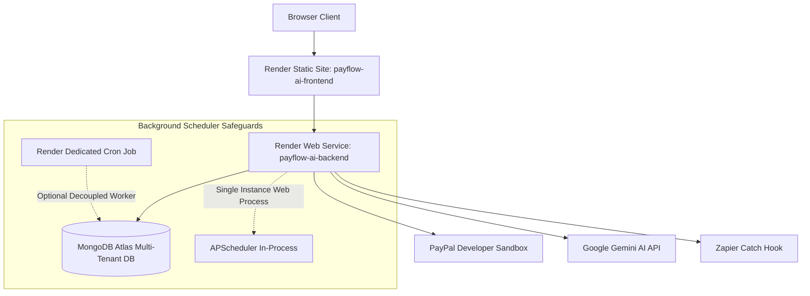

# Render Deployment Guide (Prompt 30)

This guide documents the production deployment architecture for **PAYFLOW AI** on [Render](https://render.com), utilizing the Infrastructure-as-Code Blueprint [`render.yaml`](file:///Users/apple/Desktop/FastAPI-PAYFLOW-AI-hackathon/render.yaml).

---

## 1. Production Architecture Overview

---

## 2. Blueprint Services in `render.yaml`

1. **`payflow-ai-backend` (FastAPI Web Service)**:
   - **Runtime**: Python 3.12+
   - **Build Command**: `pip install -r backend/requirements.txt`
   - **Start Command**: `cd backend && uvicorn app.main:app --host 0.0.0.0 --port $PORT --workers 2`
   - **Health Check Path**: `/health` (Monitors DB and PayPal connectivity status)
   - **Auto-Deploy**: Enabled on git push to `main`.

2. **`payflow-ai-frontend` (Static Site)**:
   - **Runtime**: Static HTML/JS
   - **Build Command**: `cd frontend && npm install && npm run build`
   - **Publish Directory**: `frontend/dist`
   - **SPA Routing Rewrite**: `/*` $\rightarrow$ `/index.html`
   - **API Host Resolution**: Automatically wires `VITE_API_BASE_URL` to the backend web service URL.

3. **`payflow-daily-reminders` (Optional Dedicated Cron Worker)**:
   - **Schedule**: `0 9 * * *` (Daily at 9:00 AM UTC).
   - **Command**: `cd backend && python -m app.jobs.reminder_job`.
   - **Purpose**: Evaluates aging buckets and creates reminder proposals without keeping a persistent worker thread if running on free/starter tiers.

---

## 3. Single-Instance Scheduler Safeguards

> [!WARNING]
> **Duplicate Execution Invariant**: If running APScheduler inside the web process (`RUN_BACKGROUND_SCHEDULER=true`), keep the backend web service scaled to **exactly 1 instance** (`numInstances: 1`). Running multiple web replicas without distributed locks (e.g. Redis) could cause simultaneous evaluation sweeps.
>
> If high availability or horizontal auto-scaling is needed in production:
> 1. Set `RUN_BACKGROUND_SCHEDULER=false` on the web service.
> 2. Enable the dedicated Render Cron service (`payflow-daily-reminders`) in `render.yaml`.

---

## 4. Required Render Dashboard Secret Configuration

Never commit `.env` files to git. Configure the following sensitive environment variables directly in the Render Dashboard:

| Variable | Recommended Value / Source | Purpose |
| :--- | :--- | :--- |
| `MONGODB_URI` | `mongodb+srv://<user>:<password>@cluster.mongodb.net/?retryWrites=true&w=majority` | Authoritative database connection. |
| `MONGODB_DATABASE` | `payflow_db` | Database name. |
| `APP_SECRET_KEY` | Auto-generated 64-char string | Used for JWT signing and HMAC signatures. |
| `PAYPAL_CLIENT_ID` | From PayPal Developer Sandbox Dashboard | OAuth2 Sandbox Client ID. |
| `PAYPAL_CLIENT_SECRET`| From PayPal Developer Sandbox Dashboard | OAuth2 Sandbox Client Secret. |
| `PAYPAL_WEBHOOK_ID` | From PayPal Developer Webhook Dashboard | ID for verifying incoming sandbox webhooks. |
| `PAYPAL_BASE_URL` | `https://api-m.sandbox.paypal.com` | **Strict Sandbox Invariant** (Live URLs rejected). |
| `AI_PROVIDER` | `gemini` | Primary AI provider. |
| `AI_MODEL` | `gemini-2.5-flash` | Lightweight, fast multimodal model. |
| `AI_API_KEY` | Google AI Studio API key | Used for natural-language invoice extraction. |
| `CORS_ORIGINS` | `https://payflow-ai-frontend.onrender.com` | Restricts API access to authorized frontend origin. |
| `ZAPIER_WEBHOOK_URL` | `https://hooks.zapier.com/hooks/catch/...` | Optional server-only Zapier Catch Hook URL. |
| `ZAPIER_SHARED_SECRET`| Secret string | Shared secret for HMAC-SHA256 payload signing. |

---

## 5. Step-by-Step Render Deployment Procedure

1. **MongoDB Atlas Network Access**:
   - In MongoDB Atlas $\rightarrow$ **Network Access** $\rightarrow$ **IP Access List**.
   - Add `0.0.0.0/0` (Allow Access from Anywhere) or whitelist Render's specific outbound IP addresses.

2. **Connect Repository to Render**:
   - Log in to the [Render Dashboard](https://dashboard.render.com).
   - Click **Blueprints** $\rightarrow$ **New Blueprint Instance**.
   - Connect the `FastAPI-PAYFLOW-AI-hackathon` GitHub repository.
   - Render will detect `render.yaml` and parse all defined services.

3. **Populate Secrets**:
   - Supply the missing secrets (`MONGODB_URI`, `PAYPAL_CLIENT_ID`, `PAYPAL_CLIENT_SECRET`, `PAYPAL_WEBHOOK_ID`, `AI_API_KEY`) when prompted.
   - Click **Apply**.

4. **Verify Live Deployment**:
   - Backend health check: `https://<backend-service>.onrender.com/health` (returns `{"status": "healthy", "database": "connected"}`).
   - PayPal Sandbox diagnostic: `https://<backend-service>.onrender.com/api/paypal/status`.
   - Frontend web application: `https://<frontend-service>.onrender.com`.

