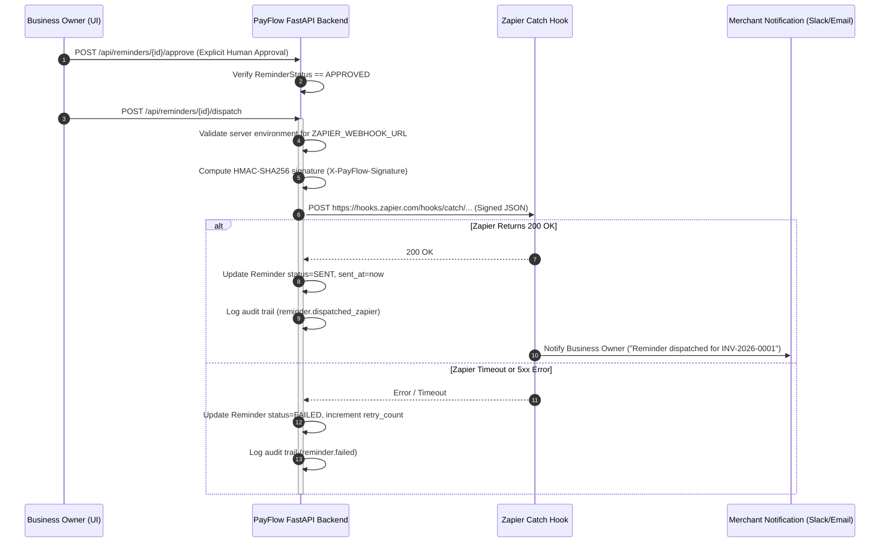

# Zapier Integration & Notification Automation (Prompt 29)

This document describes the narrow, server-side Zapier Catch Hook integration implemented for **PAYFLOW AI** to notify business owners when payment reminders are authorized and dispatched.

---

## 1. Workflow Architecture & Invariants



### Security Invariants
1. **Server-Side Only**: `ZAPIER_WEBHOOK_URL` and `ZAPIER_SHARED_SECRET` reside strictly in server environment configuration. They are **never** exposed to browser clients, client-side bundles, or diagnostic endpoints.
2. **Human-in-the-Loop Barrier**: Zapier webhooks can **never** be triggered directly by raw LLM output. Dispatch strictly requires the reminder to be in `ReminderStatus.APPROVED`, authorized by the authenticated merchant.
3. **Cryptographic Integrity**: PayFlow signs each webhook payload with HMAC-SHA256, transmitted via the `X-PayFlow-Signature` HTTP header along with an `X-PayFlow-Timestamp`.
4. **Owner-Only Notifications**: The Zap workflow notifies the *business owner* (e.g. via private Slack DM or merchant email) regarding collection status, rather than sending unvetted automated emails directly to clients.

---

## 2. Redacted Zap Configuration & Payload

### Trigger: Webhooks by Zapier (Catch Hook)
- **App**: Webhooks by Zapier
- **Event**: Catch Hook
- **Webhook URL**: `https://hooks.zapier.com/hooks/catch/[REDACTED_ACCOUNT]/[REDACTED_HOOK_ID]/`

### Sample Delivered Payload
```json
{
  "reminder_id": "rem-019a2b3c-4d5e-7f80-8910-111213141516",
  "invoice_number": "INV-2026-0001",
  "customer_name": "Acme Global Ventures",
  "customer_email": "accounting@acmeglobal.example",
  "stage": "overdue_1_3_days",
  "subject": "Follow-up regarding Invoice INV-2026-0001",
  "message_body": "Hello Acme Global Ventures,\n\nWe hope this note finds you well. This is a gentle reminder that Invoice INV-2026-0001 for $1,500.00 USD was due on November 7, 2026.\n\nYou may view and settle the invoice securely via PayPal here:\nhttps://www.sandbox.paypal.com/invoice/s/pay/INV2-SAMPLE-ID\n\nThank you for your business.\n\nBest regards,\nSarah Designer",
  "payment_link": "https://www.sandbox.paypal.com/invoice/s/pay/INV2-SAMPLE-ID",
  "approved_at": "2026-11-10T14:30:00+00:00"
}
```

### Action: Slack / Gmail Notification
- **App**: Slack (or Gmail)
- **Event**: Send Direct Message / Email to Merchant
- **Message Template**:
  > *"PayFlow Notification: Payment reminder for invoice **{{invoice_number}}** ({{customer_name}}, {{stage}}) was authorized and dispatched. Link: {{payment_link}}"*

---

## 3. Resilience, Retries & Delivery Status

- **Timeout**: 10.0-second request timeout via asynchronous HTTP client.
- **Delivery Status Tracking**:
  - `SENT`: Successfully acknowledged by Zapier (HTTP 2xx).
  - `FAILED`: Logged with `delivery_error` and incremented `retry_count`.
- **Manual Retry**: Merchants can re-dispatch failed reminders via `POST /api/reminders/{id}/retry`.

